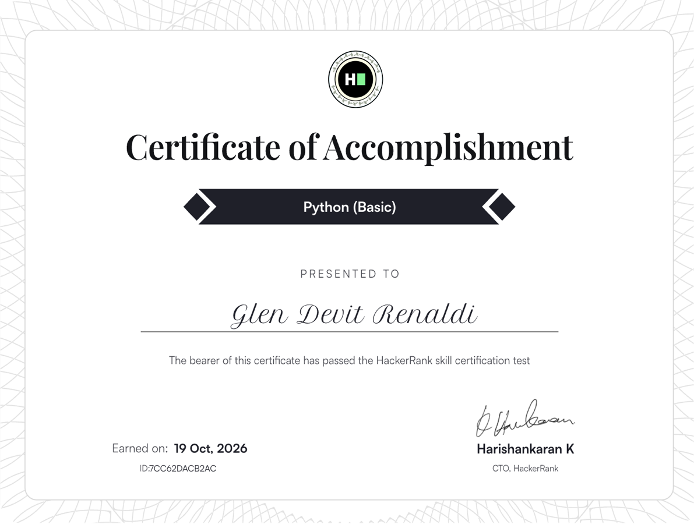
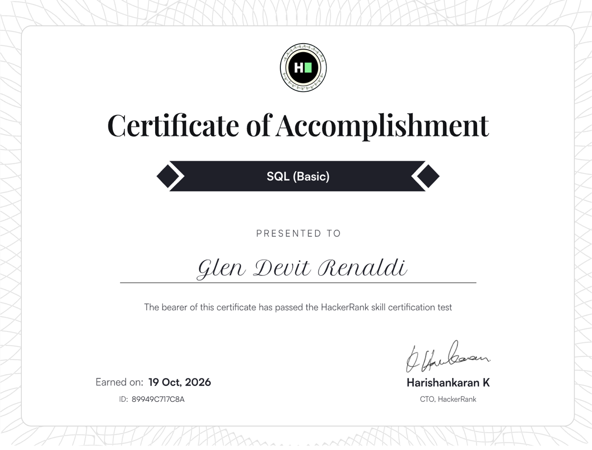

<table align="center">
  <tr>
    <td align="center">TEAM <b>Independent</b></td>
    <td align="center">BASE <b>Palangka Raya, ID</b></td>
    <td align="center">STATUS <b>Open to ML / full-stack</b></td>
    <td align="center">SEASONS <b>2024 · 2025 · 2026</b></td>
  </tr>
</table>

### ▶ [Live demo — Zoepy Petshop Jogja](https://glen1599.github.io/zoepy-petshop-jogja/)

Marketing site + admin panel, running in demo mode. No setup, no account.

---

## 🏁 Race calendar — selected work

| Rd | Project | What it is | Proof it works |
|:--:| --- | --- | --- |
| **01** | **[Coffee Leaf Disease Detection](https://github.com/glen1599/coffee-leaf-disease-yolov8)** `YOLOv8 · Flask · OpenCV` | A coffee leaf is photographed and diagnosed in one request: class, lesion boxes, confidence and a treatment protocol. Trained on 3,992 annotated images. | [Metrics](https://github.com/glen1599/coffee-leaf-disease-yolov8#model-metrics) · 31 tests · CI green · mAP@50 98.49 % |
| **02** | **[Zoepy Petshop Jogja](https://github.com/glen1599/zoepy-petshop-jogja)** `GSAP · Lenis · Supabase · Postgres` | Marketing site for a real pet shop, plus an admin panel and booking system. Every list reads from the database. | **[Live demo](https://glen1599.github.io/zoepy-petshop-jogja/)** · 24 RLS assertions verified against PostgreSQL |
| **03** | **[Optimization Algorithms](https://github.com/glen1599/optimization-algorithms-python)** `OR-Tools · CP-SAT · NumPy` | Job-shop scheduling, capacitated vehicle routing, an Ant Colony metaheuristic for VRPTW, AHP decision analysis and Prim's MST — as tested libraries, not notebooks. | 50 tests · 6 notebooks |
| **04** | **[Applied Cryptography](https://github.com/glen1599/applied-cryptography-python)** `NumPy · exact integer arithmetic` | The Hill cipher turned into a real library: Bareiss determinant, adjugate modular inverse, validated keys, any block size. | 25 tests |
| **05** | **[Machine Learning Coursework](https://github.com/glen1599/machine-learning-coursework-python)** `scikit-learn · pandas` | A semester of ML coursework, de-duplicated and organised by theme, with CLIQUE subspace clustering extracted into a tested module. | 26 notebooks · 10 tests |
| **06** | **[Library Management](https://github.com/glen1599/aplikasi-perpustakaan-java)** `Java Swing · MySQL · JasperReports` | Desktop app for a school library: members, stock, loans, returns, fines and printed receipts — stock enforced by database triggers. | 57 files · schema + sample data included |
| **07** | **[AsistenGlen](https://github.com/glen1599/asistenglen)** `Swift · SwiftUI · WebKit` | A floating browser for ChatGPT, Claude and Gemini: always on top, click-through, invisible to screen sharing, with push-to-talk dictation. | 4 Swift files · no dependencies · Carbon hotkeys |
| **08** | **[Notebook Triage](https://github.com/glen1599/notebook-triage)** `Python · gdown` | The pipeline that turned 61 scattered Colab notebooks into three publishable repositories — fetch, classify, sanitise, report. | 61 notebooks audited · raw data never published |

---

## 🏎️ Race licence — certifications

| Licence | Issuer | Earned | Credential ID | Verify |
| --- | --- | --- | --- | :--: |
| **Java (Basic)** | HackerRank | 19 Oct 2026 | `37CDBFD4F7CA` | [PDF](assets/certificates/java-basic-hackerrank.pdf) · [PNG](assets/certificates/java-basic.png) |
| **Python (Basic)** | HackerRank | 19 Oct 2026 | `7CC62DACB2AC` | [PDF](assets/certificates/python-basic-hackerrank.pdf) · [PNG](assets/certificates/python-basic.png) |
| **SQL (Basic)** | HackerRank | 19 Oct 2026 | `89949C717C8A` | [PDF](assets/certificates/sql-basic-hackerrank.pdf) · [PNG](assets/certificates/sql-basic.png) |

<b>Preview the three certificates</b>

 

---

<table>
<tr>
<td width="52%" valign="top">

</td>
<td width="48%" valign="top">

### 🛠 What I work with

**Applied ML** — object detection (YOLOv8), classical models, clustering, time series, NLP

**Backend** — Python, Flask, PostgreSQL, Supabase, RLS, SQLite

**Frontend** — TypeScript/React, GSAP + ScrollTrigger, Lenis, SwiftUI, CSS design systems

**Practice** — tests before claims, reproducible benchmarks, documented limitations

</td>
</tr>
</table>

---

### 🧠 How I work

I write down what a system does *not* do, alongside what it does. Every repository above ships
with the numbers that back its claims and the commands to reproduce them — because a model card
that only reports its best metric is not something to trust a crop with.

> [!NOTE]
> The fastest way to judge my work: open the live demo, then read the "Known limitations"
> section of any repo. The second one tells you more.

---

---

<a href="https://github.com/glen1599?tab=repositories">All repositories</a> · Lights out and away we go.

