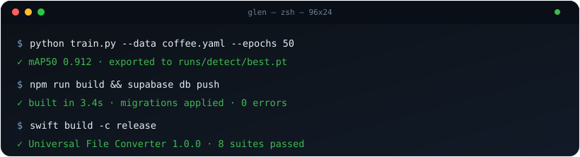

  

<h1 align="center">Hi 👋🏻, I'm Glen</h1>

<h3 align="center">Machine Learning & Full-Stack Engineer</h3>

  

  

<h2 align="center">🚀 About Me</h2>

I'm a machine learning and full-stack engineer based in Palangka Raya, Indonesia. I like problems that start as a single notebook and end as a repository with tests, sane naming, and a README someone else can actually follow.

Day to day that means computer vision with YOLOv8, optimization with OR-Tools and CP-SAT, and the occasional deep dive into time series and NLP. On the product side I build the whole thing — Supabase schema and row-level security, React/TypeScript front ends, Java/MySQL desktop apps, and Swift utilities when macOS deserves something native.

My process is unglamorous on purpose: build the smallest version, break it, read the error, fix the actual cause, write the check that proves it, ship. I'd rather have one honest test than a folder of screenshots.

When I'm not in a notebook or an editor, I'm probably turning a "wouldn't it be cool if…" into another repository nobody asked for (me included).

  

<h2 align="center">🤝 Connect</h2>

<h2 align="center">💻 Tech Stack</h2>

  

  

<h2 align="center">📊 GitHub Stats</h2>

 

<h2 align="center">⌘ Commit Activity</h2>

  

  

